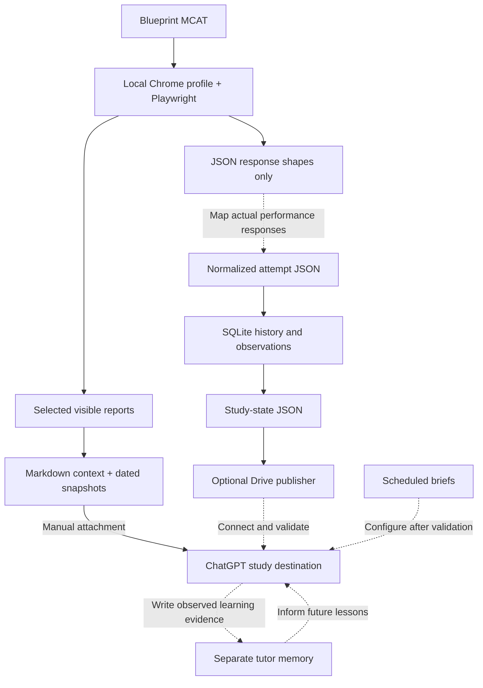

# Architecture

Solid connections show implemented code paths or the manual handoff. Dashed
connections are unimplemented or not configured. Live integrations remain unverified.

## Boundaries

- Browser profile: local credentials and persistent session state, never context data.
- Raw capture: visible report text and capture metadata; partial coverage is explicit.
- Normalized history: stable attempt IDs, timestamps, source revisions and typed fields.
- Export: replaceable view of source facts; not the owner of tutor memory.
- Tutor memory: learner reports and actual assessed responses, with evidence and dates.

No hosted service is required. Drive is an optional delivery mechanism. A local
browser uploader could be implemented once the actual ChatGPT destination is chosen
and its file-upload/replacement workflow is observed.
